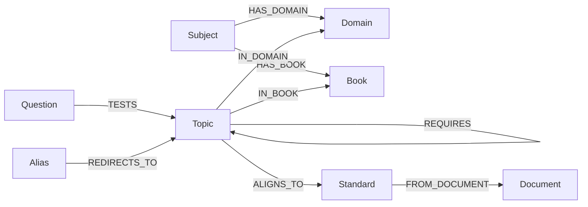

# 图数据库模式说明：LadybugDB 版

## 1. 产物与重建


| 项目    | 内容                                                              |
| ----- | --------------------------------------------------------------- |
| 数据库文件 | `graph/cn-math-taxonomy.lbdb`（单文件，约 10.7 MB，已被 `.gitignore` 忽略） |
| 引擎    | LadybugDB 0.22.3（Cypher 方言，前身 Kùzu）。 CLI `lbug`                 |


重建时脚本会先删掉旧文件再建表，写入后对每一类关系做一次边数断言（`MATCH ()-[r:TYPE]->() RETURN count(*)` 必须等于源文件条数），端点没匹配上导致静默丢边会直接报错退出。

## 2. 图模式总览



共 8 类节点、9 类关系：


| 节点         | 个数   | 含义                                                  |
| ---------- | ----: | --------------------------------------------------- |
| `Subject`  | 2    | 学科：`math`、`english`                                 |
| `Document` | 4    | 课标文件（数学 2022、高中数学 2017/2020、英语 2022、高中英语 2017/2020） |
| `Domain`   | 9    | 领域：数学 4 个、英语 5 个                                    |
| `Book`     | 43   | 教材册次：数学 23 个、英语 20 个                                |
| `Topic`    | 1503 | 知识点（数学 802 + 英语 701）                                |
| `Standard` | 426  | 课标条目（数学 310 + 英语 116）                               |
| `Question` | 6159 | 题库（数学 3355 + 英语 2804）                               |
| `Alias`    | 18   | 已删除的旧 id `cnm_ext_001`…`018`                        |


| 关系              | 方向                  | 条数                             |
| --------------- | ------------------- | ------------------------------: |
| `HAS_DOMAIN`    | Subject → Domain    | 9                              |
| `HAS_BOOK`      | Subject → Book      | 43                             |
| `IN_DOMAIN`     | Topic → Domain      | 1503                           |
| `IN_BOOK`       | Topic → Book        | 1503                           |
| `REQUIRES`      | Topic → Topic       | 2176（hard 1323 / soft 853）     |
| `ALIGNS_TO`     | Topic → Standard    | 1612（exact 801 / inferred 811） |
| `FROM_DOCUMENT` | Standard → Document | 426                            |
| `TESTS`         | Question → Topic    | 6159（其中诊断题 1503）               |
| `REDIRECTS_TO`  | Alias → Topic       | 52                             |


## 3. 节点表

字段类型为 LadybugDB 实际类型（`STRING`、`INT64`、`BOOL`、`STRING[]`、`STRUCT(...)[]`）。每张表的第一列 `id` 是主键，建库时自动建索引。

### 3.1 `Subject` 学科


| 字段     | 类型     | 说明                 |
| ------ | ------ | ------------------ |
| `id`   | STRING | `math` / `english` |
| `name` | STRING | `数学` / `英语`        |


数学和英语各自成图，**任何关系都不跨学科**（`REQUIRES` 里跨学科的边为 0 条）。英语内部小学→初中→高中可以连边。

### 3.2 `Document` 课标文件


| 字段       | 类型     | 说明                                           |
| -------- | ------ | -------------------------------------------- |
| `id`     | STRING | `cms-2022`、`cms-2017`、`ces-2022`、`ces-2017`  |
| `title`  | STRING | 课标全名                                         |
| `issuer` | STRING | 均为 `中华人民共和国教育部`                              |
| `year`   | INT64  | 2022 / 2020                                  |
| `stage`  | STRING | 适用范围，如 `义务教育第一至第四学段（1～9年级）；普通高中必修课程与选择性必修课程` |
| `url`    | STRING | 教育部发布页或 PDF 地址；`ces-2022` 没取到单独 URL，是空串      |
| `note`   | STRING | 来源与文本质量说明原文（是否逐页核对、是否扫描件识别等）                 |


`id` 前缀与 `Standard.id` 的前缀一致，所以 `FROM_DOCUMENT` 边在语义上是「这条课标条文出自哪份文件」。`cms-2017` 取自 `cn-curriculum-standards.json` 里 `source.high_school`，`ces-2017` 取自 `english.senior`。

### 3.3 `Domain` 领域


| 字段        | 类型     | 说明                                                        |
| --------- | ------ | --------------------------------------------------------- |
| `id`      | STRING | `学科:领域名`，如 `math:图形与几何`                                   |
| `name`    | STRING | `数与代数`、`图形与几何`、`统计与概率`、`综合与实践`、`语音`、`词汇`、`语法`、`日常表达`、`读写` |
| `subject` | STRING | 与 id 前缀相同的 `math` / `english`                             |


领域名在数学和英语之间不重名，但仍按 `学科:领域名` 编 id，避免以后并入同一学科时撞车。

### 3.4 `Book` 教材册次


| 字段         | 类型     | 说明                                     |
| ---------- | ------ | -------------------------------------- |
| `id`       | STRING | `学科:册次`，如 `math:七上`、`english:选择性必修第一册` |
| `name`     | STRING | 册次名，原样取自 `Topic.chapter` 的第一个空格前       |
| `subject`  | STRING | `math` / `english`                     |
| `grade`    | INT64  | 该册所有知识点共用的 `grade`（脚本会校验全册一致，不一致直接报错）  |
| `semester` | STRING | 该册共用的 `上` / `下` / `全`                  |


册次名沿用数据原文，**不是统一的教材全称**：


| 学科      | 册次写法                                       | 实际对应                                                 |
| ------- | ------------------------------------------ | ---------------------------------------------------- |
| 数学·小学   | `一年级上册` … `六年级下册`                          | 人教义务教育教科书                                            |
| 数学·初中   | `七上` … `九下`                                | 2024 审定版（九下目录非官方，待核）                                 |
| 数学·高中必修 | `高一`、`高二`                                  | 人教 A 版（2019）必修第一册、第二册。**高二不等于教学进度**，只是两册各占一个 `grade` |
| 数学·高中选必 | `选必一`、`选必二`、`选必三`                          | 人教 A 版（2019）选择性必修第一至三册，不称高三、高四                       |
| 英语·义务教育 | `三年级上册` … `九年级全册`（九年级是整册，`semester` 记 `全`） | 人教 PEP（三年级起点）、Go for it!                             |
| 英语·高中   | `必修第一册` … `选择性必修第四册`                       | 人教版（2019）                                            |


### 3.5 `Topic` 知识点


| 字段                 | 类型         | 说明                                                                           |
| ------------------ | ---------- | ---------------------------------------------------------------------------- |
| `id`               | STRING     | 见 §5                                                                         |
| `name`             | STRING     | 中文名称                                                                         |
| `subject`          | STRING     | `math` / `english`。源数据里数学没有 `subject` 字段，构建时补成 `math`                        |
| `domain`           | STRING     | 指向 `Domain.id`（`math:数与代数` 这类），冗余存一份便于直接过滤                                   |
| `grade`            | INT64      | 1–9 义务教育；数学高中 10–14（10–11 必修两册，12–14 选必三册）；英语高中 10–16（10–12 必修三册，13–16 选必四册） |
| `semester`         | STRING     | `上` / `下` / `全`。高中数学和英语高中一律 `上`（不拆上下册），九年级英语整册为 `全`                          |
| `stage`            | STRING     | 派生字段：`小学`、`初中`、`高中必修`、`高中选择性必修`。共 413 / 560 / 260 / 270                      |
| `book`             | STRING     | 指向 `Book.id`                                                                 |
| `chapter`          | STRING     | 教材章节原串，如 `七上 第一章 有理数 1.2.1`、`一年级上册 第1单元 5以内数的认识和加、减法`                        |
| `chapter_title`    | STRING     | 去掉册次和节号后的部分，如 `第一章 有理数`、`第1单元 5以内数的认识和加、减法`                                  |
| `section`          | STRING     | 节号，如 `1.2.1`、`13.1`。**958 个点为空串**（小学按单元、英语按单元、高中建模探究不带节号）                    |
| `type`             | STRING     | `conceptual` / `procedural` / `reasoning` / `application` / `modeling`       |
| `description`      | STRING     | 通俗说明（1–2 句）                                                                  |
| `mastery_criteria` | STRING\[\] | 掌握标准，通常 2–3 条                                                                |
| `is_root`          | BOOL       | 是否有 `root_reason`。全库只有 2 个 `true`：`cnm_p001`（数学）、`cne_p001`（英语）              |
| `root_reason`      | STRING     | 根节点原因，其余 1501 个为空串                                                           |


`book`、`chapter_title`、`section` 三个字段是构建时从 `chapter` 拆出来的**派生字段**，源 JSON 里没有。拆分规则：按第一个空格切出册次；末尾形如 `1.2.1` / `13.1` 的数字串当节号；切不出节号时 `section` 为空串。

### 3.6 `Standard` 课标条目


| 字段             | 类型     | 说明                                                                                                      |
| -------------- | ------ | ------------------------------------------------------------------------------------------------------- |
| `id`           | STRING | `cms-2022:4.NA.01`、`cms-2017:H.PRE.01`、`ces-2022:3.GR.05`、`ces-2017:H.B.GR.01` 等                        |
| `subject`      | STRING | 由 id 前缀判断：`cms-` → `math`，`ces-` → `english`                                                            |
| `domain`       | STRING | 领域名（与 `Domain.name` 同一套用词，但**不是**外键，课标的领域和知识点领域只是同名）                                                    |
| `theme`        | STRING | 主题/子主题，如 `数与式`。只有第四学段那部分有，237 条非空                                                                       |
| `section`      | STRING | 课标的子主题名（与 `Topic.section` 的节号不同义！这里放的是文字，如 `有理数`）                                                       |
| `clause`       | STRING | 课标原序号，如 `①`、`(1)`、`主题活动6`                                                                               |
| `text`         | STRING | 条文正文                                                                                                    |
| `page_or_ref`  | STRING | 印刷页码或 `待核`。269 条为 `待核`                                                                                  |
| `verbatim`     | BOOL   | 是否逐字原文。**三态**：`true` / `false` / `NULL`                                                                 |
| `text_status`  | STRING | 文本状态说明，如 `公开转写，未与教育部 PDF 逐页核对`；原文条目为空串                                                                  |
| `wording_note` | STRING | 转写时的拼接、改写说明，6 条非空                                                                                       |
| `elective`     | BOOL   | 是否整条选学。只有 3 条 `true`：`cms-2022:4.NA.26`（三元一次方程组）、`cms-2022:4.GG.51`（过圆外一点作切线）、`cms-2022:4.GG.52`（切线长定理） |


`verbatim` 的 `NULL` 不等于 `false`：第四学段那 157 条来自教育部 PDF（该 PDF 是扫描图像，正文由识别得到），源文件里**没有这个键**，所以构建时保留为 `NULL`，不替它下判断。现有 `false` 269 条、`NULL` 157 条、`true` 0 条 —— 即没有任何一条在数据里被标成逐字核对过的原文。

### 3.7 `Question` 题目


| 字段                  | 类型                                                 | 说明                                                     |
| ------------------- | -------------------------------------------------- | ------------------------------------------------------ |
| `id`                | STRING                                             | `知识点id_q序号`，如 `cnm_p001_q1`                            |
| `topic_id`          | STRING                                             | 所属知识点，冗余存一份（`TESTS` 边同义）                               |
| `type`              | STRING                                             | `choice` 3854 / `numeric` 2276 / `short` 23 / `self` 6 |
| `difficulty`        | STRING                                             | `basic` 2968 / `standard` 2912 / `advanced` 279        |
| `prompt`            | STRING                                             | 题干                                                     |
| `answer`            | STRING                                             | 答案。选择题存选项文字或字母键，numeric 存数值字符串，统一为 `STRING`            |
| `explanation`       | STRING                                             | 解析                                                     |
| `verify`            | STRING                                             | 自动核验表达式（受限 Python 求值）。5627 题有，532 题无                   |
| `choices`           | STRUCT(key STRING, text STRING, figure STRING)\[\] | 选项数组。非选择题为空数组（2305 题）。`figure` 为选项内嵌 SVG，14 个题用到       |
| `figure`            | STRING                                             | 题干配图 SVG，106 题有，其余空串                                   |
| `unordered`         | BOOL                                               | 答案是否不计顺序，32 题 `true`                                   |
| `accept`            | STRING\[\]                                         | 额外可接受答案，23 题非空                                         |
| `fixed_from_source` | STRING                                             | 题干相对原题的修改说明，3 题非空                                      |
| `hide_choice_text`  | BOOL                                               | 选项文字是否隐藏（只看图选），11 题 `true`；源字段名是 `hideChoiceText`      |


选择题的选项**不做成节点**，用 `LIST<STRUCT>` 存在题目属性里。理由：选项从不被其他东西引用，拆成节点只会把图撑到 2 万多点却不带来可遍历性；需要按选项检索时用 `UNWIND q.choices` 即可。

### 3.8 `Alias` 旧 id


| 字段     | 类型     | 说明                            |
| ------ | ------ | ----------------------------- |
| `id`   | STRING | `cnm_ext_001` … `cnm_ext_018` |
| `name` | STRING | 旧节点名，如 `整数四则运算与运算律`           |


这些 id 已从 `topics.json` 删除（方案 b），只保留跳转关系。`REDIRECTS_TO.position` 是 0 起的顺序，`targets` 里第几个就排第几 —— 一个旧 id 可以指向多个小学知识点，共 52 条边。

## 4. 关系表

关系一律**单向**，反向遍历用 `<-[:TYPE]-`。除注明外没有属性。

### 4.1 结构关系：`HAS_DOMAIN`、`HAS_BOOK`、`IN_DOMAIN`、`IN_BOOK`


| 关系           | 方向               | 属性  | 说明                |
| ------------ | ---------------- | --- | ----------------- |
| `HAS_DOMAIN` | Subject → Domain | 无   | 学科包含哪些领域          |
| `HAS_BOOK`   | Subject → Book   | 无   | 学科包含哪些册次          |
| `IN_DOMAIN`  | Topic → Domain   | 无   | 知识点归属领域，每个点恰好 1 条 |
| `IN_BOOK`    | Topic → Book     | 无   | 知识点归属册次，每个点恰好 1 条 |


这四条纯为导航。`Topic.domain` / `Topic.book` 同时也存了 id，所以既可以直接按属性过滤（快），也可以走边（可读性好）。

### 4.2 `REQUIRES` 先修关系（最重要的一条）


| 属性         | 类型     | 说明              |
| ---------- | ------ | --------------- |
| `strength` | STRING | `hard` / `soft` |
| `reason`   | STRING | 一句中文理由          |


**方向：`(A:Topic)-[:REQUIRES]->(B:Topic)` 表示「学 A 之前需要 B」，A 依赖 B。** 这与 `dependencies.json` 的 `topicId` / `prerequisiteId` 完全一致，没有反转。

- `hard`：不会 B 基本无法学 A；`soft`：会 B 对学 A 有明显帮助，但不是硬门槛。这个区分是 AI 的主观判断，未经教师审核。
- 只保留直接先修，并已在源数据里做过传递约简：`hard` 边仅在存在另一条全 `hard` 路径时才删，`soft` 边在存在任何其他路径时即删。**图里不做二次约简**，所以看到某条边「缺失」通常意味着它能由更近的先修推出。
- 先修的年级不高于后续知识点；除小学英语→初中英语、初中→高中这类跨学段边外，不存在逆向边。
- 数学和英语之间 0 条边。

正向查祖先（沿依赖一直往回走）和反向查后继：

```cypher
// 「配方法」往回 4 层，看先修链最深能落到哪
MATCH p=(t:Topic {id:'cnm_221'})-[:REQUIRES*1..4]->(a:Topic)
RETURN DISTINCT a.stage, a.name, length(p) AS depth ORDER BY depth;

// 哪些知识点把「完全平方公式」当直接先修
MATCH (d:Topic {name:'完全平方公式'})<-[:REQUIRES]-(x:Topic) RETURN x.id, x.name;
```

`*1..4` 这种变长路径会按不同路径重复返回同一个节点，需要**去重**（`DISTINCT` 或 `collect(DISTINCT ...)`）。

### 4.3 `ALIGNS_TO` 课标对齐


| 属性           | 类型     | 说明                              |
| ------------ | ------ | ------------------------------- |
| `confidence` | STRING | `exact` / `inferred`            |
| `note`       | STRING | `inferred` 时必须写明理由；942 条边有 note |


`exact` 表示条款正文直接点名，`inferred` 表示前提、特例、延伸或教材细化。映射由 AI 生成，未经课程专家审核。多数知识点挂 1 条（1392 个），107 个挂 2 条，2 个挂 3 条，2 个挂 0 条（`cnm_130`、`cnm_192`）。另有 28 条课标没有任何知识点挂靠（多为作图、欣赏类和选学内容）。

### 4.4 `FROM_DOCUMENT` 课标出处

Standard → Document，无属性。一条课标恰好属于一份文件，`Document.id` 就是 `Standard.id` 冒号前的前缀。

### 4.5 `TESTS` 出题


| 属性           | 类型   | 说明         |
| ------------ | ---- | ---------- |
| `is_primary` | BOOL | 是否是知识点的诊断题 |


Question → Topic，每个知识点恰好有 1 条 `is_primary: true`（共 1503 条），即 `questions.json` 里的 `_q1`，其题干与 `topics.json` 的 `diagnostic_question` 对应。取某点的诊断题：

```cypher
MATCH (q:Question)-[r:TESTS]->(t:Topic {id:'cnm_221'}) WHERE r.is_primary
RETURN q.prompt, q.answer;
```

### 4.6 `REDIRECTS_TO` 旧 id 跳转


| 属性         | 类型    | 说明         |
| ---------- | ----- | ---------- |
| `position` | INT64 | 0 起的顺序，0–3 |


Alias → Topic，无过滤条件时按 `position` 排序取第一个，就是页面跳转的默认落点；诊断工具则展开全部 targets。

## 5. id 命名规则


| 对象             | 规则                                            | 例子                                      |
| -------------- | --------------------------------------------- | --------------------------------------- |
| `Subject`      | `math` / `english`                            | `math`                                  |
| `Domain`       | `学科:领域名`                                      | `english:日常表达`                          |
| `Book`         | `学科:册次`                                       | `math:七上`、`english:必修第一册`               |
| `Topic`（数学·初中） | `cnm_NNN`                                     | `cnm_221`                               |
| `Topic`（数学·小学） | `cnm_pNNN`                                    | `cnm_p001`                              |
| `Topic`（数学·高中） | `cnm_hNNN`，必修到 `cnm_h143`，选择性必修从 `cnm_h144` 起 | `cnm_h027`                              |
| `Topic`（英语·小学） | `cne_pNNN`                                    | `cne_p148`                              |
| `Topic`（英语·初中） | `cne_jNNN`                                    | `cne_j174`                              |
| `Topic`（英语·高中） | `cne_hNNN`                                    | `cne_h155`                              |
| `Standard`（数学） | `cms-<年份>:<学段或模块>.<领域>.<序号>`                  | `cms-2022:4.GG.07`、`cms-2017:H.FUN.03`  |
| `Standard`（英语） | `ces-<年份>:<级别或模块>.<领域>.<序号>`                  | `ces-2022:2.VO.04`、`ces-2017:H.S.GR.02` |
| `Question`     | `<Topic.id>_q<序号>`                            | `cnm_p001_q3`                           |
| `Alias`        | `cnm_ext_NNN`                                 | `cnm_ext_002`                           |


`Standard.id` 的后半段是本项目自编编号，**不是教育部原编号**（见 [docs/standards-mapping.md](standards-mapping.md)）。知识点 id 三套（初中 / 小学 / 高中）不混用，英语与数学也不共用号段。

## 6. 完整性约定与已知空值

构建前做过一轮外键核对，导入时对每类关系做了边数断言，当前库满足：


| 检查项                         | 结果             |
| --------------------------- | -------------- |
| `REQUIRES` 端点不存在的边          | 0              |
| 知识点引用了不存在的课标 id             | 0              |
| 题目的 `topicId` 不在知识点表里       | 0              |
| `Alias.targets` 指向不存在的小学知识点 | 0              |
| 重复的 id（8 类节点全部）             | 0              |
| 跨学科 `REQUIRES` 边            | 0              |
| 每个知识点都有且仅有一条诊断题             | 是（1503 / 1503） |


字段层面的约定：

- **空字符串表示「无此值」**，除 `verbatim` 外没有用 `NULL`。取数时判空要写 `t.section = ''`，不是 `IS NULL`。
- `verbatim` 是唯一可空字段（`NULL` 157 / `false` 269 / `true` 0），理由见 §3.6。
- `Topic.section` 有 958 个空串，`Topic.root_reason` 有 1501 个空串，`Question.verify` 有 532 个空串，`Question.choices` 有 2305 个空数组。
- `Topic.is_root` / `Question.unordered` / `Question.hide_choice_text` / `Standard.elective` 都规范成布尔值，源数据里字段缺失即 `false`。

## 7. 源 JSON 与图的对应


| 源文件 / 字段                                                                                        | 图里的落点                                                                 |
| ----------------------------------------------------------------------------------------------- | --------------------------------------------------------------------- |
| `topics.json` 每条                                                                                | 一个 `Topic` 节点 + 一条 `IN_DOMAIN` + 一条 `IN_BOOK`                         |
| `topics.json` 无 `subject` 字段的 802 条（数学）                                                         | `Topic.subject = 'math'`                                              |
| `topics.json` 的 `chapter`                                                                       | 拆成 `book` / `chapter_title` / `section`，同时保留 `chapter` 原串             |
| `topics.json` 的 `standards[]`                                                                   | `ALIGNS_TO` 边（`confidence`、`note` 搬到边上）；1612 条引用去重后是 426 个 `Standard` |
| `topics.json` 的 `diagnostic_question`                                                           | 不单独建节点，与 `questions.json` 的 `_q1` 重复；诊断题用 `TESTS.is_primary` 取        |
| `topics.json` 的 `root_reason`                                                                   | `Topic.root_reason` + `Topic.is_root = true`                          |
| `dependencies.json` 每条                                                                          | 一条 `REQUIRES` 边（`strength`、`reason`）                                  |
| `cn-curriculum-standards.json` 的 `items[]`                                                      | `Standard` 节点 + `FROM_DOCUMENT` 边                                     |
| `cn-curriculum-standards.json` 的 `source` / `english` / `source.high_school` / `english.senior` | 4 个 `Document` 节点                                                     |
| `questions.json` 每条                                                                             | 一个 `Question` 节点 + 一条 `TESTS` 边                                       |
| `questions.json` 的 `choices`                                                                    | `Question.choices` 的 `STRUCT[]`，不建节点                                  |
| `questions.json` 的 `hideChoiceText`                                                             | `Question.hide_choice_text`（改了命名风格）                                   |
| `id-aliases.json` 的 `aliases`                                                                   | `Alias` 节点 + `REDIRECTS_TO` 边（`position` 来自数组下标）                      |
| `id-aliases.json` 的 `description`（文件级说明）                                                        | 没有入图，见源文件本身                                                           |
| `verification_report.json`、`second_pass_log.json`、`_qbatches/`                                  | 没有入图（是生成与核验过程记录，不是知识结构）                                               |


## 8. 常用查询

```cypher
// 整体规模
MATCH (n) RETURN label(n) AS 类型, count(*) AS 数量 ORDER BY 数量 DESC;

// 某个知识点的全景：领域、册次、直接先修
MATCH (t:Topic {id:'cnm_h027'})-[:IN_DOMAIN]->(d:Domain), (t)-[:IN_BOOK]->(b:Book)
OPTIONAL MATCH (t)-[:REQUIRES]->(p:Topic)
RETURN t.name, d.name, b.name, t.grade, collect(DISTINCT p.name) AS 直接先修;

// 按册次统计知识点数
MATCH (t:Topic)-[:IN_BOOK]->(b:Book) WHERE b.subject = 'math'
RETURN b.name, b.grade, count(*) AS 知识点 ORDER BY b.grade, b.name;

// 反查一条课标被哪些知识点挂靠
MATCH (t:Topic)-[a:ALIGNS_TO]->(s:Standard {id:'cms-2022:4.NA.01'})
RETURN s.text, a.confidence, collect(t.name) AS 挂靠点;

// 找没有课标映射的知识点
MATCH (t:Topic) WHERE NOT EXISTS { MATCH (t)-[:ALIGNS_TO]->(:Standard) } RETURN t.id, t.name;

// 跨学段的硬先修边分布
MATCH (a:Topic)-[r:REQUIRES]->(b:Topic) WHERE r.strength = 'hard' AND a.stage <> b.stage
RETURN a.stage, b.stage, count(*) AS 边数 ORDER BY 边数 DESC;

// 两个知识点之间的最短先修路径（「圆柱、圆锥与球」一路回溯到「1到5各数的认识」）
MATCH p = (a:Topic {id:'cnm_h106'})-[:REQUIRES* SHORTEST 1..6]->(b:Topic {id:'cnm_p001'})
UNWIND nodes(p) AS n
RETURN n.stage AS 学段, n.name AS 知识点;
```

最短路径这里的写法是 0.22 的方言，见下一节。

命令行下一次性执行（`lbug` 没有 `-c` 参数，用 stdin 喂）：

```bash
"MATCH (t:Topic) RETURN t.name LIMIT 5;" | lbug graph/cn-math-taxonomy.lbdb
```

## 9. 0.22 方言注意

本文件里所有示例都在 LadybugDB 0.22.3 上实跑过。和 Neo4j 的习惯写法有出入的地方：


| 想做的事     | 不能用                                                                     | 用这个                                                   |
| -------- | ----------------------------------------------------------------------- | ----------------------------------------------------- |
| 最短路径     | `shortestPath((a)-[:R*..8]->(b))`（无此函数），`ALL SHORTEST`（解析报错）            | `MATCH p = (a)-[:R* SHORTEST 1..6]->(b)`              |
| 取路径上的节点名 | `[n IN nodes(p) | n.name]`（列表推导里 `n` 不在作用域），`nodes(p)[0].name`（不支持下标访问） | `UNWIND nodes(p) AS n RETURN n.name`                  |
| 取路径上的边属性 | `[x IN relationships(p) | x.strength]`                                  | `UNWIND relationships(p) AS r RETURN r.strength`      |
| 路径起点终点   | `startNode(r)` / `endNode(r)`（无此函数）                                     | 路径两端先各自绑定变量                                           |
| 判断字段为空   | `IS NULL`                                                               | 普通字段是空字符串，写 `= ''`；只有 `Standard.verbatim` 会真的是 `NULL` |


另外两点：

- 变长路径 `*1..4` 按不同路径分别返回，同一个祖先节点会出现多次，需要 `DISTINCT`。
- `lbug` CLI 没有 `-c` / `--query` 参数，一次性查询要把语句从 stdin 喂进去；也可以用 `-i script.cypher` 指定启动脚本。

## 10. 局限

- **图只搬运，不修正。** 知识点粒度是否合适、先修边该不该存在、`hard` / `soft` 分得对不对，都是源数据的问题（AI 生成、未经教师审核），导入过程不改变任何一条判断。原文状态声明见 [README.md](../README.md) 开头。
- **课标层级没有建模。** 课标的「领域 → 主题 → 子主题」只以 `Standard.domain` / `theme` / `section` 三个字符串存在，不是可遍历的节点。想按主题聚合得自己按字符串分组。
- **教材没有章节点。** `chapter_title` 是字符串（如 `第一章 有理数`），不是 `Chapter` 节点；同一个章名在不同册次里重复出现也无从区分。目前按 `Book` + `section` 前缀聚合。
- **题目不是图的一部分。** `Question` 挂到知识点上便于取题，但题与题之间没有关系（先修顺序只由知识点决定），选项也不是节点。
- **没有学习者状态。** 掌握度、作答记录、诊断结果都不在库里，诊断算法仍在 `diagnose/engine.js`。
- **页码不全。** `Standard.page_or_ref` 里只有第四学段那 157 条有课标印刷页码，其余 269 条是「待核」；教材页码全库都没有。
- **没有全文索引。** 按名称搜用 `CONTAINS`（如 `WHERE t.name CONTAINS '配方'`），能做前缀/子串匹配，不建倒排索引；1503 个知识点、6159 道题的规模下够用。